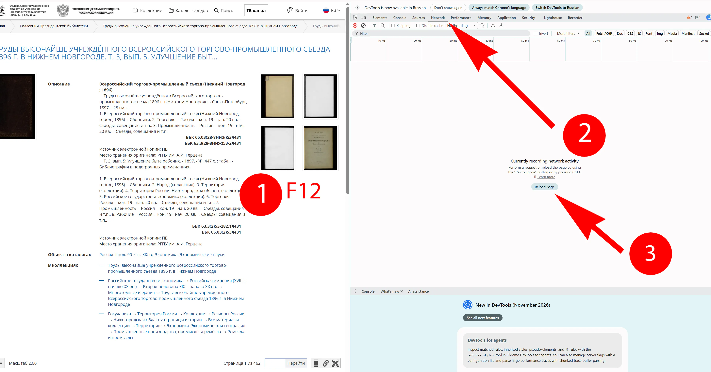
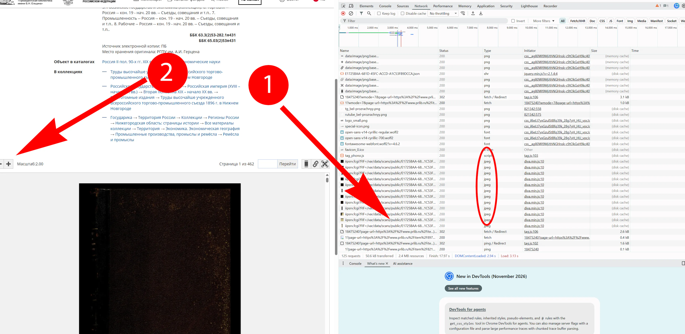
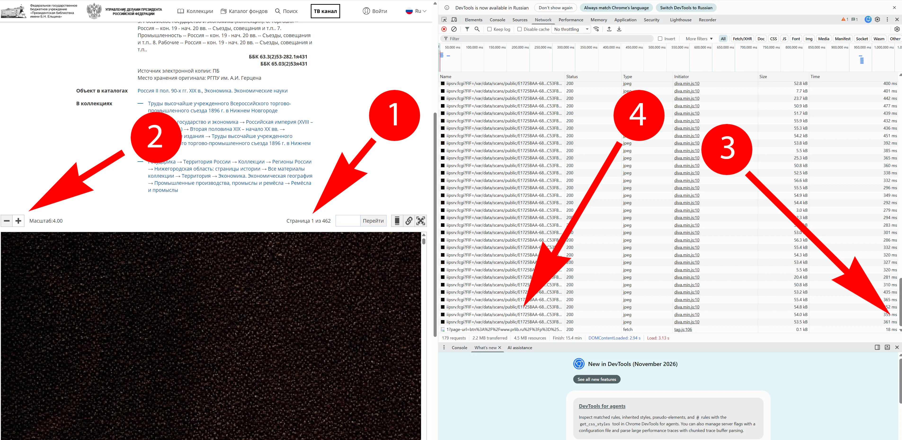
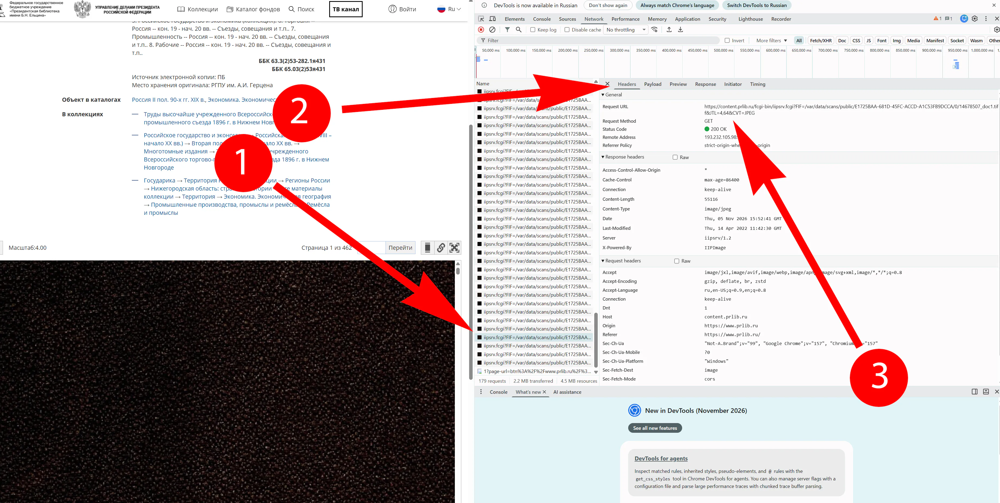
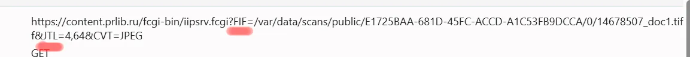
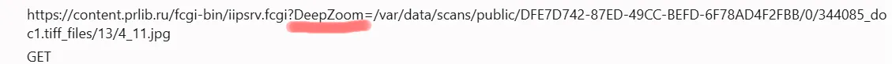
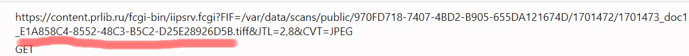
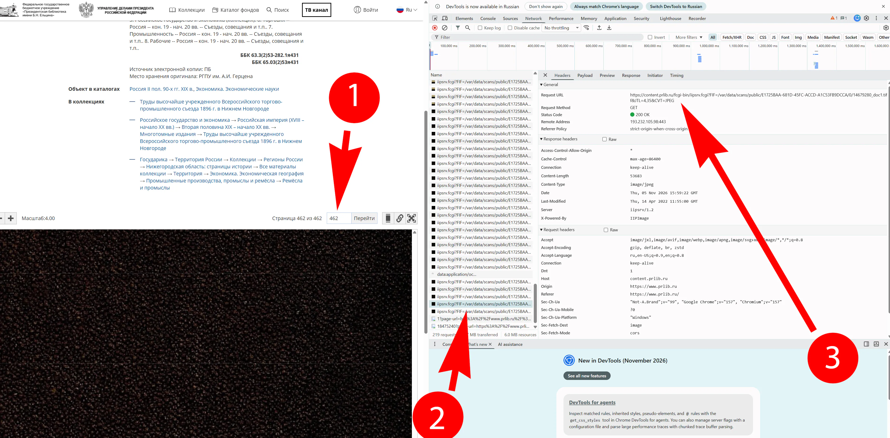
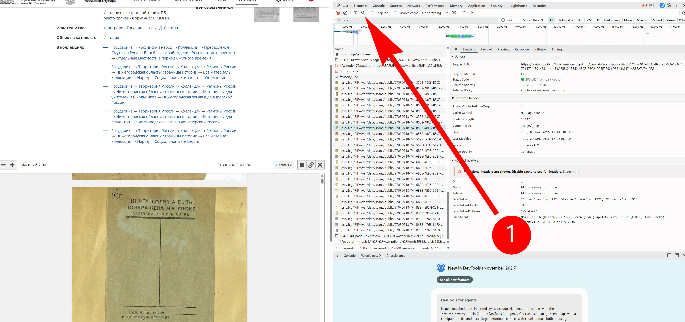
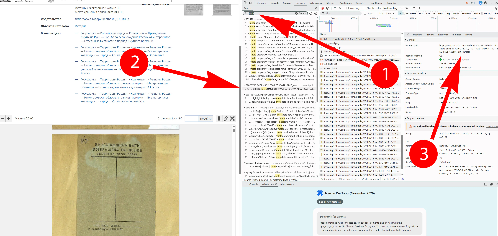

# PrLib — загрузчик документов

PrLib скачивает фрагменты из просмотрщика Президентской библиотеки и собирает каждую страницу в отдельный PNG. Вы выбираете максимальное разрешение, которое сервер отдаёт через просмотрщик. Поддерживаются ссылки FIF/JTL, DeepZoom и Metadata. Типы ссылок я сам придумал для классификации, на самом деле я не знаю как они называются.

Пример ссылки FIF/JTL
https://content.prlib.ru/fcgi-bin/iipsrv.fcgi?**FIF**=/var/data/scans/public/91B2CD521FED4A13B82CE46B795D0E03/0/12578682_doc1.tiff&**JTL**=5,127&CVT=JPEG

Пример ссылки DeepZoom
https://content.prlib.ru/fcgi-bin/iipsrv.fcgi?**DeepZoom**=/var/data/scans/public/7C1669B9-8AB1-4E56-9DB8-D46BB3F45507/0/344137_doc1.tiff_files/11/1_4.jpg

Пример ссылки Metadata
https://content.prlib.ru/fcgi-bin/iipsrv.fcgi?FIF=/var/data/scans/public/**B2A718A7-F19E-4E58-951E-3381D5433E86**/2560181/2560183_doc1_**C9F60A2E-DD61-4A68-8DD3-A3F88D8069FA**.tiff&JTL=2,1&CVT=JPEG

Программа рассчитана на Windows 10 и 11 x64.

## Где взять ссылки для FIF/JTL, DeepZoom и Metadata

1. Откройте электронную копию документа в просмотрщике Президентской библиотеки и перейдите к первому нужному изображению.

2. Нажмите **F12** и откройте вкладку **«Сеть»** (**Network**). Очистите список запросов, перейдите на первую страницу документа затем увеличьте изображение до нужного вам качества. Справа в столбце **Type** будут появляться файлы с расширением **JPEG**.

3. Кликните на одном из этих изображений в конце списка, перейдите во вкладку **Headers** и скопируйте ссылку из поля **Request URL**

4. **Распознаем ссылки**
Это ссылка FIF/JTL

Это ссылка DeepZoom

Это ссылка Metadata – перед расширением tiff, буквенно-числовой код и у каждой страницы он свой

## Куда вставлять ссылки ##
**Для FIF/JTL и DeepZoom**
1. Ссылку на фрагмент первой страницы копируем и вставляем в поле **"Первое изображение"**
2. Перейдите на последнюю страницу документа и проделайте те же действия, но ссылку вставьте в поле **"Последнее изображение"**

**Для FIF/JTL (альтернативный вариант) и Metadata**
1. В строке поиска введите **"meta"**

2. Найдите ссылку **"...prlib.ru/metadata/public/..."**
3. Кликните по ней с скопируйте ссылку на файл JSON из поля **Request URL**

4. Вставьте ссылку в в поле **"Первое изображение"**

## Если появятся ошибки

1. Пишите на почту или
2. Создайте Issues

## Автор

Старков Илья. Для связи: `ipbatman69@gmail.com`.

[Поддержать автора на Boosty](https://boosty.to/ipbatman/donate)
